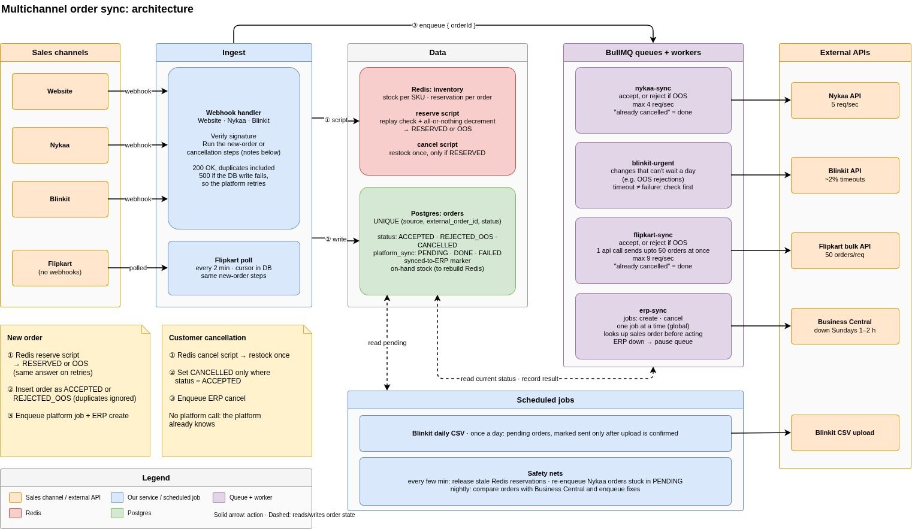

# Mars-Cosmetics-Submission

## Architecture

## Ingestion Phase

The backend listens to Nykaa, Blinkit and website webhooks and polls flipkart for new orders every 2 minutes.

### Order replay protection
After verifying their legitimacy, it calls the order replay protection service, which executes a lua script on Redis. The script tries to create an object with order id, order source and order status as the key. If one already exists, the backend stops processing the order any further and sends back a statuscode 200 response.

### Inventory Consistency
The backend then executes a SKU quantity decrement lua script on Redis. If it fails, we mark the order as Out-of-Stock in the db and schedule a job that informs blinkit and nykaa of this. Flipkart sends the order status in it's bulk API.

### DB write and BullMQ job schedule
The webhook data is stored in the db. It then processes them differently depending on the source:
 - A job is enqueued to the relevant queue in case the order is from nykaa, or an Out-of-Stock blinkit order. 
 - In case of flipkart poll, the jobs are enqueued with an array of upto 50 orders.
 - In case the order is from our own website, the backend directly updates the db and enqueues a job to the ERP queue regarding the same. 
 - In case of blinkit and flipkart, store the order in the db and wait for the polling service to pick it up.

### Order cancellation
1) Run order replay protection to ensure that this isnt a duplicate event.
1) Increase SKU quantity on Redis. 
1) Update the order in the db with `CANCELLED` status.
1) Enqueue a job to cancel the order in the ERP. 

## BullMQ queues and job processors
The backend has three type of queues and their respective processors that perform different actions on different third party APIs and have different backoff, pause and limiter settings:

### Nykaa queue
#### Settings
 - 4 request per second limiter to make sure that the processor never exceeds the rate limit.
 - Retry setup to trigger with increasing intervals based on the number of attempts upto 5 times

#### Process
 - Fetch order from db based on the order ID provided in the job. 
 - Stop further execution if order has been cancelled. 
 - Accept order through Nykaa's rest API.
 - Throw error if we get timeout, rate limit error. 
 - Throw unprocessable error otherwise so that BullMQ doesnt retry the job. Update the redis SKU quantity and transaction status in db otherwise. 

### Flipkart queue
#### Settings
 - 9 request per second limiter since flipkart allows 10.
 - Each job carries an array of upto 50 order IDs so that one job is one bulk API call.
 - Retry setup to trigger with increasing intervals based on the number of attempts upto 5 times

#### Process
 - Read the current status of the claimed orders from the db.
 - Send accept for `ACCEPTED` orders and reject for `REJECTED_OOS` orders in a single call to flipkart's bulk API.
 - Go through the response for each order. Successful ones are marked `DONE` and the ones that failed permanently are marked `FAILED` (only that order, not the whole batch). "Already cancelled" response is treated as done.
 - Release the lease on orders that failed with a retryable error and throw error so that BullMQ retries the job. The retry only resends these orders since the rest are already `DONE`.

### Blinkit urgent queue
Most blinkit orders dont go through a queue at all, they are sent in the daily CSV upload (see scheduled jobs). This queue is only for changes that cant wait a day, mainly Out-of-Stock rejections.

#### Settings
 - Retry setup to trigger with increasing intervals based on the number of attempts upto 5 times

#### Process
 - Fetch order from db based on the order ID provided in the job. 
 - Stop further execution if order has already been sent or cancelled. 
 - Reject order through blinkit's rest API.
 - Around 2% of blinkit's API calls timeout, so a timeout doesnt mean that the call failed. Check the order's state on blinkit before retrying wherever the API allows it and stop if the change has already gone through.
 - Mark the order as `DONE` in the db on success.

### ERP queue
Has two type of jobs, `create` and `cancel`.

#### Settings
 - Global concurrency of 1 (`setGlobalConcurrency(1)`) so that only one job runs at a time across all workers. This makes sure that a create and cancel job for the same order never run together. Each call takes a few hundred ms so it can still process thousands of orders an hour.
 - Business Central goes down for 1-2 hours on sundays. In case of a 503 or connection error, the whole queue is paused for 15 minutes instead of using up the retry attempts.
 - Retry setup to trigger with increasing intervals based on the number of attempts upto 5 times

#### Process for create job
 - Fetch order from db based on the order ID provided in the job. 
 - Look up the sales order in Business Central by External Document No.
 - If the order has been cancelled in the meantime, cancel the sales order if it exists. This covers the case where a previous create call timed out but actually went through. Do nothing otherwise.
 - If the order is accepted and no sales order exists, create one. 
 - Set `erp_synced_at` in the db on success.

#### Process for cancel job
 - Look up the sales order in Business Central by External Document No.
 - Cancel it if it exists and isnt already cancelled. 

Since both the jobs check the ERP before doing anything, it doesnt matter which one runs first or how many times they run.

## Error handling
All the processors handle errors the same way:
 - Nothing to do (order already sent or cancelled): return normally so that BullMQ marks the job as completed.
 - Rate limit error (429): call `worker.rateLimit()` and throw `RateLimitError` so that the queue pauses without using up an attempt.
 - Timeout or 5xx: throw error so that BullMQ retries with exponential backoff. The call might have gone through, so check before acting again wherever possible.
 - Bad request or auth error: throw `UnrecoverableError`, mark the order `FAILED` in the db and send an alert.
 - Retries exhausted: the job lands in the failed set and sends an alert. The order stays `PENDING` in the db so that the sweeper can pick it up again.

Every job only carries the order ID and the processor always reads the current state of the order from the db when it runs. This way a job never acts on stale data and its safe to run any job twice.

The webhook handler returns 200 for every order including duplicates, and returns 500 only if the db write fails so that the platform retries.

## Scheduled jobs
All of these are BullMQ job schedulers, so each of them runs only once per tick no matter how many instances of the backend are running.

### Flipkart poll
 - Runs every 2 minutes.
 - Fetches new orders and cancellations since the cursor stored in the db. The time windows overlap slightly so that no order is missed. 
 - Runs the same new order and cancellation steps as the webhook handler.
 - Moves the cursor forward only after the orders are committed in the db.

### Blinkit daily CSV
1) Pick up all blinkit orders that are still `PENDING` in the db.
1) Write them to a CSV and create an `upload_batches` row for it.
1) Upload the CSV to blinkit. 
1) Mark the orders in that batch as `DONE` only after the upload is confirmed. If it fails, release them so that the next run picks them up.

### Reservation reconciliation
Runs every few minutes. Finds Redis reservations older than ~15 minutes that dont have a matching order in the db and releases it's stock. This happens when the stock gets reserved but the db write fails and the platform never retries the webhook.

### Sweeper
Runs every few minutes. Re-enqueues nykaa orders, and flipkart orders in chunks of 50, that are still `PENDING` and dont have an active lease. This takes care of jobs that never got enqueued after the db commit, crashed workers and expired leases.

### ERP reconciliation
Runs every night. Compares recent orders in the db with Business Central and enqueues a `create` or `cancel` job for anything that doesnt match.

## Data model

### Postgres
 - `orders`: One row per order. `status` can be `ACCEPTED`, `REJECTED_OOS` or `CANCELLED`. `platform_sync` can be `PENDING`, `DONE`, `FAILED` or `NOT_REQUIRED` (for website orders). `platform_lease_until` makes sure that two jobs dont send the same order at once. `upload_batch_id` links a blinkit order to the CSV it went out in. `erp_synced_at` is set once the order is confirmed in Business Central. Has `UNIQUE (source, external_order_id)` to catch duplicate orders and `CHECK` constraints on the status columns.
 - `order_items`: One row per SKU per order with `qty > 0` and `UNIQUE (order_id, sku)`. Quantities are summed per SKU before reserving stock.
 - `inventory`: On-hand stock per SKU. Used to rebuild Redis in case of a failure.
 - `poll_cursors`: Where the flipkart poll left off.
 - `upload_batches`: One row per blinkit CSV upload so that a confirmation marks exactly the orders in that file as sent.

### Redis
 - `stock:{inv}:<sku>`: Available stock.
 - `resv:{inv}:<source>:<orderId>`: Reservation state of the order (`RESERVED`, `OOS` or `CANCELLED`), kept for ~7 days. This is the same key that the order replay protection checks, and it also makes sure that a cancellation doesnt restock twice.
 - `resv-index:{inv}`: Sorted set of reservations by time so that the reservation reconciliation job can find the abandoned ones.

All inventory keys share the `{inv}` hash tag so they land in one slot and the lua scripts keep working in case we move to Redis Cluster.

## Observability
Metrics and alerts we would setup on day one:
 - Orders stuck in `PENDING` per platform past 15 minutes. Marketplaces auto cancel orders that arent acknowledged in time, so this is the most important one.
 - New jobs in the failed set of any queue. These have used up all the retries or hit an `UnrecoverableError` (eg. expired credentials) so someone needs to look at them.
 - Orders not synced to the ERP past 1 hour, muted during the sunday downtime. Warehouse works off the ERP so a missing order doesnt get shipped.
 - Stock released by reservation reconciliation. Should be 0 on a normal day, otherwise either the db write is failing or a platform isnt retrying.

## Scope
Left out of v1:
 - Partial cancellations and returns. Only whole order cancellations are handled.
 - Cancellations after shipping. We dont track shipping state yet so these are handled manually.

## AI tool usage
Used it for market research and to make the architecture diagram. 